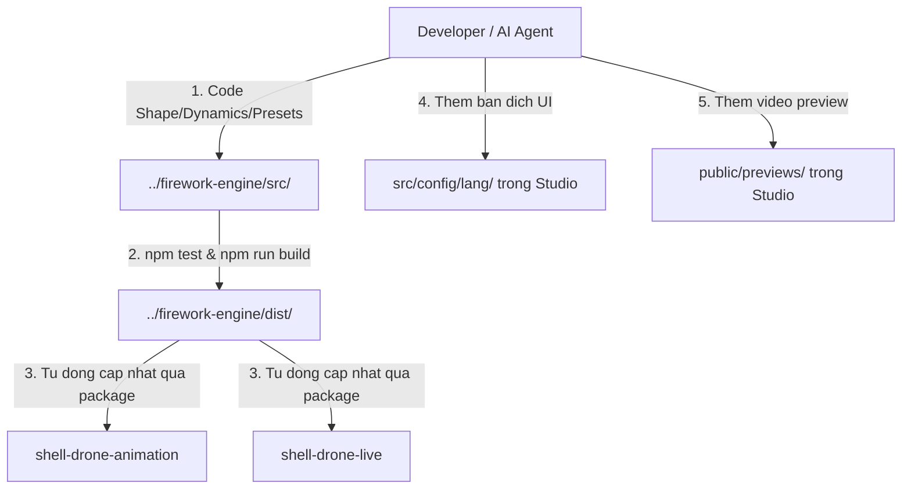

# Huong dan tao va chinh sua Phao hoa (Firework Composition Workflow)

Tai lieu nay cung cap ban do kien truc va quy trinh chuan de lap trinh vien hoac AI Agent them moi Hinh dang (Shape), Dong luc hoc no (Dynamics), Bo bo tro (Modifiers), Hieu ung quang hoc (Visual Effects) hoac Mau khoi dong nhanh (Preset Templates) thong qua thu vien dung chung **`firework-engine`**.

---

## 1. Nguyen tac cot loi: Thuc thi tai `firework-engine`

Toan bo he thong phao hoa hien tai duoc van hanh boi package **`@shell-drone/firework-engine`** nam tai thu muc:
`../firework-engine` (hoac `e:\firework-engine`).



### Cac tep tin chiu trach nhiem chinh (trong `../firework-engine/`):

1. **Quan ly Taxonomy & Templates:**
   - `../firework-engine/src/factories/FireworkCompositionHelper.js`: Trung tam quan ly danh muc `AVAILABLE_SHAPES`, `AVAILABLE_DYNAMICS`, `AVAILABLE_MODIFIERS`, `AVAILABLE_EFFECT_TAGS` va `PRESET_TEMPLATES`.
2. **Hinh hoc khong gian (Shape - t = 0):**
   - `../firework-engine/src/factories/BurstShapeGenerator.js`: Tinh toan vector huong tam 3D ban dau cua cac hat. Tuyet doi khong chua logic vat ly hay hieu ung dong.
   - `../firework-engine/src/factories/TextGlyphAtlas.js`: Ma tran diem ky tu cho phao hoa chu / so (`text_word`).
3. **Dong luc hoc & Vat ly hat (Dynamics - t > 0):**
   - `../firework-engine/src/factories/BurstEffectProcessor.js`: Dieu khien van toc, ma sat khong khi, trong luc rieng biet (vi du: flow, willow, falling-leaves, snow, wave, galaxy-spin, bouquet-comet).
4. **Hieu ung quang hoc & Active Effects (Visual Effects):**
   - `../firework-engine/src/factories/BurstEffectProcessor.js` & `../firework-engine/src/systems/FireworkSystem.js`: Xu ly nhap nhay (strobe, white-strobe, glitter-strobe), no lach tach (crackle), an hien (ghost), tach sao (crossette), tia xu nong noc (tadpole-flurry), vet sang (trail).
   - Quy tac bat buoc: Cac the trong Active Effects phai mang tinh dung chung (universal), ap dung truc tiep duoc tren cac hat `burstParticles` cua moi loai phao hoa ma khong bi troi buoc vao mot preset rieng le.
5. **Khoi dong nhanh (Preset Factory):**
   - `../firework-engine/src/factories/ShellPresetFactory.js`: Khai bao preset khoi dong nhanh (templates chuan `snake_case`).
   - `../firework-engine/src/factories/ProceduralShellGenerator.js`: Phat sinh phao hoa dong theo tier qua tang.
6. **Cau hinh Tham so & Video Metadata:**
   - `../firework-engine/src/config/fireworks.js`: Khai bao he so hat `shapeMultipliers` va `effectMultipliers`.
   - `../firework-engine/src/config/effectPreviews.js`: Khai bao metadata, the phan loai va duong dan video preview cho tung hieu ung.

---

## 2. Bieu mau huong dan lap trinh (Step-by-Step Guides)

### A. Them mot Hinh dang moi (New Shape)

1. **Buoc 1 (Tai `../firework-engine`):**
   - Them ten shape vao `AVAILABLE_SHAPES` trong `../firework-engine/src/factories/FireworkCompositionHelper.js`.
   - Dang ky shape trong `resolveShape(shellType)` cua `../firework-engine/src/factories/BurstShapeGenerator.js`.
   - Viet logic tinh vector 3D trong `direction(...)` cua `../firework-engine/src/factories/BurstShapeGenerator.js`:
     ```javascript
     if (shape === 'my_shape') {
       const x = Math.cos(angle) * 1.0;
       const y = Math.sin(angle) * 1.0;
       const z = (Math.random() - 0.5) * 0.2;
       return new THREE.Vector3(x, y, z).normalize();
     }
     ```
   - Khai bao he so hat trong `shapeMultipliers` tai `../firework-engine/src/config/fireworks.js`.
   - Khai bao metadata va duong dan `previews/shapes/<shape_name>.mp4` trong `../firework-engine/src/config/effectPreviews.js`.

2. **Buoc 2 (Kiem thu & Build tai `../firework-engine`):**
   - Mo terminal tai `../firework-engine` va chay:
     ```bash
     npm test
     npm run build
     ```
   - Dam bao 100% unit tests pass va `dist/` duoc bien dich thanh cong.

3. **Buoc 3 (Tai project Studio `shell-drone-animation`):**
   - Them ban dich ten shape vao `options.shapeType` trong ca 4 file ngon ngu (`src/config/lang/{en,vi,zh,ja}.js`).
   - Copy file video minh hoa vao `./public/previews/shapes/<shape_name>.mp4`.
   - Chay `npm run media:mute-previews` de toi uu hoa video stream.

---

### B. Them mot Dong luc hoc moi (New Dynamics)

1. **Buoc 1 (Tai `../firework-engine`):**
   - Them ten dynamics vao `AVAILABLE_DYNAMICS` trong `../firework-engine/src/factories/FireworkCompositionHelper.js`.
   - Dang ky ten dynamics vao `SUPPORTED_EFFECTS` va viet xu ly trong `../firework-engine/src/factories/BurstEffectProcessor.js`:
     ```javascript
     BurstEffectProcessor.registerEffect('my_dynamics', {
       updateVelocity(velocity, index, deltaTime, age, maxLife, effectState) {
         velocity.y += Math.sin(age * 4) * 0.02;
         velocity.multiplyScalar(0.995);
         return {
           gravityScale: 0.15,
           spawnTrail: true,
           trailLife: 0.4,
           trailIntensity: 0.5
         };
       }
     });
     ```
   - Khai bao he so hat trong `effectMultipliers` tai `../firework-engine/src/config/fireworks.js`.
   - Khai bao metadata trong `../firework-engine/src/config/effectPreviews.js`.

2. **Buoc 2 (Kiem thu & Build tai `../firework-engine`):**
   - Chay `npm test` va `npm run build` tai `../firework-engine`.

3. **Buoc 3 (Tai project Studio `shell-drone-animation`):**
   - Them ban dich vao `options.dynamicsType` trong ca 4 file ngon ngu (`src/config/lang/{en,vi,zh,ja}.js`).
   - Dat video preview vao `./public/previews/dynamics/<dynamics_name>.mp4` va chay `npm run media:mute-previews`.

---

### C. Them mot Hieu ung quang hoc moi (New Visual Effect Tag)

1. **Buoc 1 (Tai `../firework-engine`):**
   - Them tag vao `AVAILABLE_EFFECT_TAGS` trong `../firework-engine/src/factories/FireworkCompositionHelper.js`.
   - Xu ly co hieu ung trong `initialize(...)` va `updateVelocity(...)` cua `../firework-engine/src/factories/BurstEffectProcessor.js` (hoac shader trong `FireworkSystem.js` neu la shader moi).
   - Khai bao metadata trong `../firework-engine/src/config/effectPreviews.js`.

2. **Buoc 2 (Kiem thu & Build tai `../firework-engine`):**
   - Chay `npm test` va `npm run build` tai `../firework-engine`.

3. **Buoc 3 (Tai project Studio `shell-drone-animation`):**
   - Them tag chip trong `src/ui/PropertyInspector.js` (neu co can thiep UI).
   - Them ban dich ten effect vao `fields` trong ca 4 file ngon ngu (`src/config/lang/{en,vi,zh,ja}.js`).
   - Dat video preview vao `./public/previews/effects/<effect_name>.mp4` va chay `npm run media:mute-previews`.

---

### D. Dang ky mot Preset / Quick Template moi

1. **Buoc 1 (Tai `../firework-engine`):**
   - Them template vao `PRESET_TEMPLATES` trong `../firework-engine/src/factories/FireworkCompositionHelper.js`:
     ```javascript
     strobe_kamuro_glitter: {
       shape: 'sphere',
       dynamics: 'willow',
       modifiers: { pistil: false, instantBurst: false },
       effects: ['strobe', 'glitter-strobe']
     }
     ```
   - Dang ky preset vao `presetMenuEntries` va `presetsRegistry` trong `../firework-engine/src/factories/ShellPresetFactory.js`.
   - Khai bao metadata trong `../firework-engine/src/config/effectPreviews.js`.

2. **Buoc 2 (Kiem thu & Build tai `../firework-engine`):**
   - Chay `npm test` va `npm run build` tai `../firework-engine`.

3. **Buoc 3 (Tai project Studio `shell-drone-animation`):**
   - Them ban dich ten preset vao `options.preset` trong cac file ngon ngu.
   - Dat video vao `./public/previews/presets/<preset_name>.mp4` va chay `npm run media:mute-previews`.

---

## 3. Quy dinh Thu muc Video Preview (Video Preview Directory Rules)

Moi loai phao hoa co thu muc luu tru video minh hoa rieng biet trong `./public/previews/` cua app Studio:

| Loai phan tu | Thu muc luu tru video | Dinh dang ten file | Vi du |
| :--- | :--- | :--- | :--- |
| **Shape** | `./public/previews/shapes/` | `<shape_name>.mp4` | `./public/previews/shapes/heart.mp4` |
| **Dynamics** | `./public/previews/dynamics/` | `<dynamics_name>.mp4` | `./public/previews/dynamics/willow.mp4` |
| **Effects & Modifiers** | `./public/previews/effects/` | `<effect_name>.mp4` | `./public/previews/effects/strobe.mp4` |
| **Presets** | `./public/previews/presets/` | `<preset_name>.mp4` | `./public/previews/presets/crown_kamuro.mp4` |

---

## 4. Nguyen tac bat buoc (Enforced Rules)

- **Cap nhat tai Engine duy nhat**: Khong bao gio sua logic phao hoa trong `shell-drone-animation/src/factories/`. Luon thuc hien tai `../firework-engine`.
- **Chay test va build truoc khi release**: Moi commit o `firework-engine` deu phai pass 100% qua `npm test` va build thanh cong qua `npm run build`.
- **Mac dinh khong them Smoke**: Mac dinh khi tao moi bat ky loai phao hoa nao, tuyet doi khong tu dong them khoi (`burstSmoke: false`, `launchSmoke: false`). Smoke chi duoc phep them khi nguoi dung co yeu cau ro rang.
- **Ten preset chuẩn snake_case**: Format `{primary_category}_{variant}_{modifier}` (vi du `strobe_dying_embers`, `willow_falling_comets`).
- **Khong dung Icons/Emojis**: Giu toan bo ma nguon, comment, giao dien va tai lieu thuan van ban (text-only).
