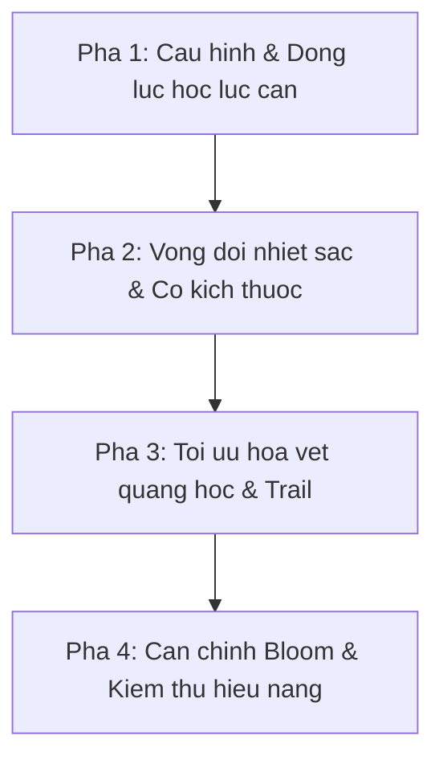

# Ke hoach nang cap tinh chan thuc cho he thong hat phao hoa (Realistic Firework Particle Dynamics & Thermal Lifecycle Plan)

## 1. Tong quan va Muc tieu (Executive Summary & Objectives)

Tai lieu nay xac lap ke hoach ky thuat de nang cap toan dien do chan thuc cua he thong hat phao hoa trong ung dung, dua tren danh gia chuyen mon tu chuyen gia do hoa thoi gian thuc.

### Cac tru cot ky thuat trong tam
1. **Hoa tron quang hoc va Bloom HDR (Optical Blending & UnrealBloomPass)**: Dong bo hoa tron cong `THREE.AdditiveBlending` voi `depthWrite: false` tren tat ca cac lop hat va tinh chinh `UnrealBloomPass` de hieu ung chong lan hat phat sang ruc ro.
2. **Dong luc hoc luc can va roi tu do (Aerodynamic Drag & Gravity)**: Mo phong hien tuong ham phanh do luc can khong khi trong 0.2s - 0.4s dau sau khi no truoc khi trong luc keo hat roi xuong (Apex Hang Time).
3. **Vong doi buc xa nhiet sac va thu nho kich thuoc (Thermal Black-body Radiation & Dynamic Shrink)**: Chuyen doi sac do hat tu trang vang loa sang mau hoa chat dac trung, roi sang cam, do sam va tan bien, kem theo viec teo nho kich thuoc vat ly.
4. **Vet chuyen dong luu anh quang hoc (Motion Persistence & Short Trails)**: Ve cac vi tri lich su ngan voi do mo giam dan hoac toi uu hoa [TrailSystem.js](./src/systems/TrailSystem.js) de loai bo hien tuong dut doan chuyen dong.
5. **Tinh ngau nhien huu co (Organic Dispersion & Non-uniformity)**: Bo sung do lech van toc bung no, thoi gian song va luc can giua cac hat de pha vo hinh hoc nhan tao qua hoan hao.

---

## 2. Phan tich kien truc hien tai va Khoang trong ky thuat (Architecture Gap Analysis)

### 2.1. Hoa tron quang hoc (Blending & Depth Testing)
- **Hien trang**:
  - `globalBurstMaterial` trong [./src/systems/FireworkSystem.js](./src/systems/FireworkSystem.js) da co `depthWrite: false` va `blending: THREE.AdditiveBlending`.
  - [./src/systems/TrailSystem.js](./src/systems/TrailSystem.js) va [./src/render/InstancedShellRenderer.js](./src/render/InstancedShellRenderer.js) cung su dung Additive Blending.
- **Khoang trong**:
  - Shader phao hoa chua co nguong chong lan vuot muc HDR (over-exposure) ro ret de kich hoat pham vi bloom cuc dai cua `UnrealBloomPass` trong [./src/core/PostProcessingPipeline.js](./src/core/PostProcessingPipeline.js).
  - Can chuan hoa tham so bloom threshold va bloom strength phu hop theo tung muc Graphics Quality.

### 2.2. Dong luc hoc luc can (Aerodynamic Drag)
- **Hien trang**:
  - Trong [./src/systems/FireworkSystem.js](./src/systems/FireworkSystem.js), hat nhat dinh chi cong gia toc trong luc `p.velocity.y += GRAVITY * deltaTime * finalGravityScale` va dich chuyen vi tri truc tiep.
  - Chi mot so preset rat nho (nhu `isDyingEmber`) co giam van toc `p.velocity.multiplyScalar(0.994)`.
- **Khoang trong**:
  - Hat phao hoa no (aerial stars) thuc te bung ra voi van toc ban dau rat cao (40-70 m/s), sau do lap tuc chiu luc can khong khi cap so nhan ($F_{drag} = -\frac{1}{2} \rho C_d A v^2$).
  - Thieu luc can khien hat bay deu deu ra xa thay vi no bung cuc nhanh roi dung lai lung lo tren khong trung truoc khi roi.

### 2.3. Vong doi mau sac va kich thuoc (Color Cooling & Size Decay)
- **Hien trang**:
  - Thuoc tinh `aOpacity` chi mo dan theo ham mu `BURST_FADE_EXPONENT` o giai doan cuoi `dissolveStart`.
  - Mau sac `p.baseColor` giu nguyen suot ca vong doi (ngoai tru hieu ung nhap nhay `white-strobe` hoac `sparking`).
  - Kich thuoc `aSize` khong co ham thu nho theo thoi gian song ma co dinh theo chieu cao no.
- **Khoang trong**:
  - Phao hoa hoa chat chay theo nguyen ly vat ly nhiet do: nong nhat o thoi diem no (trang/vang loa, size lon) -> nhiet do giam lam lo mau muon kim loai (size tieu chuan) -> nguoi lanh chuyen sang cam/do sam (size teo nho) -> tat han.

### 2.4. Vet duoi quang hoc (Motion Trails)
- **Hien trang**:
  - Phai sinh hat roi rac qua `TrailSystem.spawnTrailParticle()`.
  - Khi hat phao no bay toc do cao o 60 FPS, cac cham trail co the cach xa nhau tao cam giac roi rac chu khong lien mach nhu vet sang trong mat nguoi.
- **Khoang trong**:
  - Thieu co che luu tru cac vi tri truoc do ($t-1, t-2, t-3$) cua hat chinh de tao vet keo lien tuc voi do mo giam dan.

---

## 3. Thiet ke giai phap chi tiet (Detailed Technical Design)

### Tru cot 1: Dong luc hoc hat va Luc can khong khi (Aerodynamic Drag & Gravity Dynamics)

#### Mo hinh vat ly
Ap dung cong thuc giam toc khong khi theo buoc thoi gian $\Delta t$:
```javascript
const dragFactor = Math.exp(-p.dragCoefficient * deltaTime);
p.velocity.x *= dragFactor;
p.velocity.y *= dragFactor;
p.velocity.z *= dragFactor;
p.velocity.y += GRAVITY * deltaTime * p.gravityScale;
```

#### Tham so cau hinh tai [./src/config/fireworks.js](./src/config/fireworks.js)
```javascript
BURST: {
  baseSpeed: 65,
  baseLife: 2.2,
  baseDrag: 2.4,        // He so luc can tieu chuan
  dragJitter: 0.5,      // Do phan tan luc can giua cac hat (+- 0.5)
  speedJitter: 0.18,    // Do lech van toc ban dau (+- 18%)
  lifeJitter: 0.22,     // Do lech thoi gian song (+- 22%)
  dissolveStart: 0.60
}
```

---

### Tru cot 2: Vong doi nhiet sac va Kich thuoc (Thermal Color Ramp & Size Decay)

#### Mo hinh duong cong nhiet sac (Thermal Spectrum Curve)
Moi hat phao hoa se trai qua 4 giai doan theo ti le vong doi $t = \frac{age}{maxLife} \in [0.0, 1.0]$:
1. **Giai doan 1 ($t \in [0.00, 0.12]$) - Phat hoa nhiet do cao (Incandescent Flash)**:
   - Mau sac: Pha tron giua `white (0xffffff)` hoac `warm-white (0xfffae6)` voi ti le 70% va mau hoa chat goc 30%.
   - Kich thuoc: Phong dai $1.25 \times$ de gia lap quang loa sang.
2. **Giai doan 2 ($t \in [0.12, 0.62]$) - Giai doan chay on dinh (Chemical Signature)**:
   - Mau sac: Mau dac trung cua preset (Xanh, Do, Vang, Tim, Hong).
   - Kich thuoc: Giu o muc chuan $1.0 \times$.
3. **Giai doan 3 ($t \in [0.62, 0.88]$) - Ha nhiet (Thermal Cooling)**:
   - Mau sac: Chuyen dich dan tu mau goc sang mau cam ho phach (`0xff7a18`) roi do sam (`0xb01808`).
   - Kich thuoc: Thu nho dan ve $0.65 \times$.
4. **Giai doan 4 ($t \in [0.88, 1.00]$) - Than hong tan bien (Dying Embers & Extinction)**:
   - Mau sac: Do tham toi (`0x550a04`), opacity suy giam nhanh theo ham mu.
   - Kich thuoc: Teo nho xuong $0.20 \times$ truoc khi bi loai bo hoan toan.

#### Tich hop vao Shaders cua FireworkSystem
Bo sung attribute `aLifeRatio` vao `globalBurstGeometry`:
- **Vertex Shader**:
  ```glsl
  attribute float aSize;
  attribute float aOpacity;
  attribute float aLifeRatio;
  varying float vOpacity;
  varying float vLifeRatio;

  void main() {
    vOpacity = aOpacity;
    vLifeRatio = aLifeRatio;
    
    // Thu nho dong theo vong doi
    float sizeDecay = 1.0;
    if (aLifeRatio < 0.12) {
      sizeDecay = mix(1.3, 1.0, aLifeRatio / 0.12);
    } else if (aLifeRatio > 0.62) {
      float t = (aLifeRatio - 0.62) / 0.38;
      sizeDecay = mix(1.0, 0.2, t);
    }
    gl_PointSize = aSize * sizeDecay;
    ...
  }
  ```
- **Fragment Shader**:
  Nhan them anh huong cua `vLifeRatio` de pha mau nhiet sac truoc khi xuat ra `diffuseColor`.

---

### Tru cot 3: Vet duoi quang hoc lien tuc (Motion Persistence & History Trail)

#### Phuong an 1: Tinh chinh TrailSystem (Uu tien thuc hien truoc)
- Dieu chinh [./src/systems/TrailSystem.js](./src/systems/TrailSystem.js) de hat duoi duoc phong thich voi van toc ke thua mot phan van toc hat me (`p.velocity * 0.25`).
- Bo sung luc can khong khi `dragScale` de cac hat trail dung lai nhanh chong tao thanh vet roi tu nhien thay vi bay loan xa.
- Giam kich thuoc hat trail ve cuoi vong doi cua chinh no de tao cam giac vuot nhon (tapered tail).

#### Phuong an 2: Ring Buffer vi tri lich su tren Instanced / Multi-point (Giai doan nang cao)
- Luu 3 vi tri truoc do ($pos_{t-1}, pos_{t-2}, pos_{t-3}$) vao buffer.
- Noi suy rendering voi alpha giam theo cap so nhan: $1.0 \rightarrow 0.45 \rightarrow 0.20 \rightarrow 0.08$.

---

### Tru cot 4: Tinh ngau nhien huu co (Organic Dispersion)

Trong phan giai thuat sinh hat cua [./src/factories/BurstShapeGenerator.js](./src/factories/BurstShapeGenerator.js) va [./src/systems/FireworkSystem.js](./src/systems/FireworkSystem.js):
- **Van toc bung**: `speed = baseSpeed * (1.0 + (Math.random() - 0.5) * speedJitter)`.
- **Vong doi**: `maxLife = baseLife * (1.0 + (Math.random() - 0.5) * lifeJitter)`.
- **Luc can ca the**: `drag = baseDrag * (1.0 + (Math.random() - 0.5) * dragJitter)`.

Nho co 3 yeu to nay, hinh cau bung no se khong bao gio bi phang hoac tat dong loat, ma se co nhung hat vuot len truoc, nhung hat lui lai sau, va tat rai rac rat tu nhien.

---

## 4. Ke hoach trien khai theo tung pha (Phased Implementation Roadmap)



### Pha 1: Cau hinh tap trung va Dong luc hoc luc can (Physics & Aerodynamic Drag)
1. **Cap nhat File cau hinh**:
   - File: [./src/config/fireworks.js](./src/config/fireworks.js)
   - Them cac hang so `baseDrag`, `dragJitter`, `speedJitter`, `lifeJitter` vao block `BURST`.
2. **Cap nhat Bo sinh hat**:
   - File: [./src/factories/BurstShapeGenerator.js](./src/factories/BurstShapeGenerator.js)
   - Tich hop do lech van toc ngau nhien vao vector bung ban dau.
3. **Cap nhat Vong lap cap nhat hat**:
   - File: [./src/systems/FireworkSystem.js](./src/systems/FireworkSystem.js)
   - Ap dung `dragFactor = Math.exp(-drag * deltaTime)` vao van toc moi hat tai moi frame.
   - Dam bao hat hãm phanh ro ret truoc khi trong luc keo xuong.

### Pha 2: Vong doi nhiet sac va Co giam kich thuoc (Thermal Cooling & Size Decay)
1. **Nang cap Buffer Attributes**:
   - File: [./src/systems/FireworkSystem.js](./src/systems/FireworkSystem.js)
   - Bo sung attribute `aLifeRatio` (Float32Array) vao `globalBurstGeometry`.
2. **Nang cap Shaders trong FireworkSystem**:
   - File: [./src/systems/FireworkSystem.js](./src/systems/FireworkSystem.js)
   - Tich hop logic co kich thuoc trong vertex shader (`gl_PointSize`).
   - Tich hop cong thuc nhiet sac trong fragment shader (trang vang $\rightarrow$ mau chuan $\rightarrow$ cam do $\rightarrow$ sam den).
3. **Nang cap Bo xu ly hieu ung**:
   - File: [./src/factories/BurstEffectProcessor.js](./src/factories/BurstEffectProcessor.js)
   - Cung cap ho tro mau lam mat cho cac preset dac biet (willow, crysanthemum, kamuro).

### Pha 3: Toi uu hoa vet quang hoc va Trail (Motion Trails & Optical Persistence)
1. **Dieu chinh TrailSystem**:
   - File: [./src/systems/TrailSystem.js](./src/systems/TrailSystem.js)
   - Bo sung co che ke thua van toc hat me cho trail.
   - Them luc can de hat trail co do truot em va thu nho dau cuoi (tapering).
2. **Giam thieu hien tuong roi rac o toc do cao**:
   - Tinh chinh khoang cach phong thich hat trail de tranh bi dut quang tren man hinh 60Hz/120Hz.

### Pha 4: Can chinh Post-processing va Kiem thu toan dien (Bloom Calibration & Testing)
1. **Can chinh UnrealBloomPass**:
   - File: [./src/core/PostProcessingPipeline.js](./src/core/PostProcessingPipeline.js)
   - Can chinh nguong `threshold` (0.82 - 0.88), `strength` (1.2 - 1.4) va `radius` (0.4 - 0.5) de tao quang toa mem mai khong bi bet sang trang toan man hinh.
2. **Kiem thu hieu nang tren cac muc do hoa**:
   - Kiem tra tren 3 muc: Low, Medium, High.
   - Dam bao so luong draw call khong tang va FPS duy tri on dinh >= 60 FPS voi 5000+ hat dong thoi.
3. **Chay bo kiem thu tu dong**:
   - Chay toan bo test suite: `npm test`.

---

## 5. Tieu chi nghiem thu (Acceptance Criteria)

| Ma AC | Tieu chi | Phuong phap kiem tra |
|---|---|---|
| **AC-01** | Cac hat bung no co gia toc ham phanh ro ret truoc khi roi | Quan sat chuyen dong cham dan cua hinh cau truoc khi xuat hien duong cong parabol |
| **AC-02** | Hat co pha loa sang trang vang o 10-15% dau vong doi | Quan sat hieu ung quang no (flash ignition) ngay tai tam no |
| **AC-03** | Hat chuyen dan sang sac cam va do sam truoc khi bien mat | Kiem tra mau sac cua hat o giai doan cuoi cua cac qua phao mau xanh, do, vang |
| **AC-04** | Kich thuoc hat teo nho dan khi het vong doi | Hat bien mat mot cach thanh thoat, khong bi giat tat dot ngot |
| **AC-05** | Vet sang chuyen dong muot ma, khong bi dut cham | Quan sat phao co hieu ung trail o toc do bay nhanh |
| **AC-06** | Hieu nang duy tri 60 FPS tren may tieu chuan | Chay ban trinh dien phao hoa 10 qua lien tiep, kiem tra chi so FPS |
| **AC-07** | Tat ca cac bai kiem thu don vi deu vuot qua 100% | `npm test` khong co loi nao |

---

## 6. Quan ly rui ro (Risk Management)

1. **Rui ro qua tai GPU do tinh toan Fragment Shader phuc tap**:
   - *Giai phap*: Giu thuat toan pha mau trong fragment shader o dang ham giai tich nhe (mix va step), tranh vong lap (for-loop) hoac dieu kien re nhanh phuc tap.
2. **Rui ro sai lech quy dao cac preset dac biet (nhu willow, ring, crossette)**:
   - *Giai phap*: Cho phep cac preset ghi de (override) he so luc can `dragCoefficient` thong qua [./src/factories/BurstEffectProcessor.js](./src/factories/BurstEffectProcessor.js).
3. **Rui ro bloom lam chay sang cac doi tuong khac (Drone, Canh quan)**:
   - *Giai phap*: Dung Layer Masking hoac dam bao chi nhung pixel co cuong do mau HDR > 1.0 moi phat bloom.
